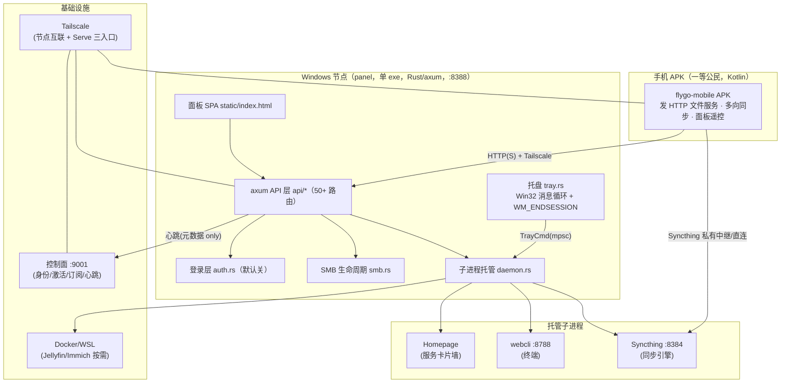
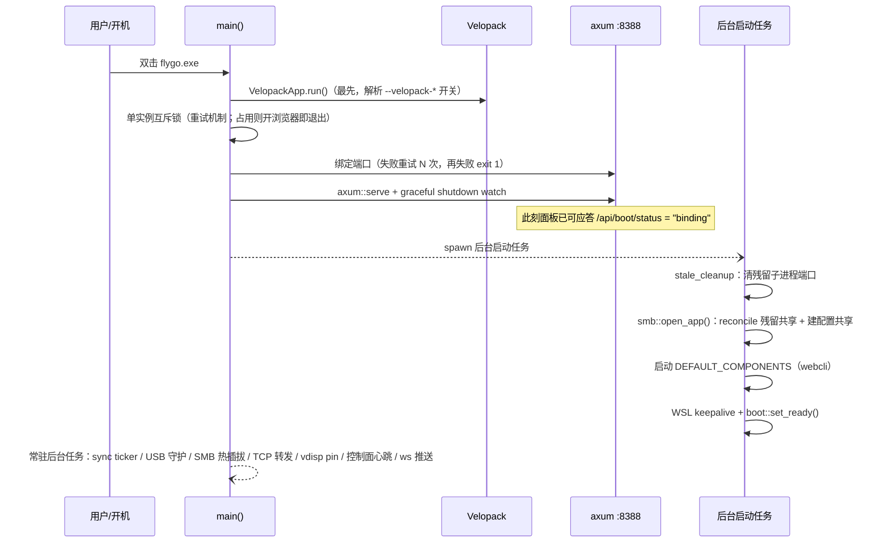
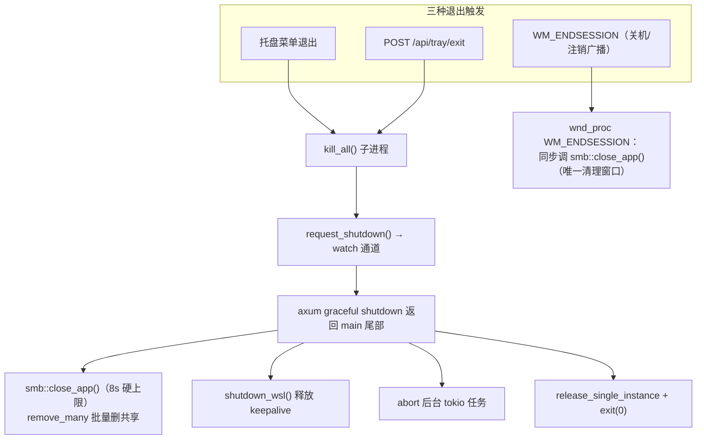
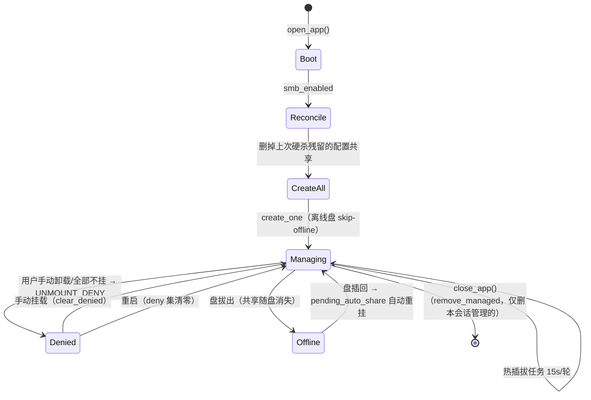
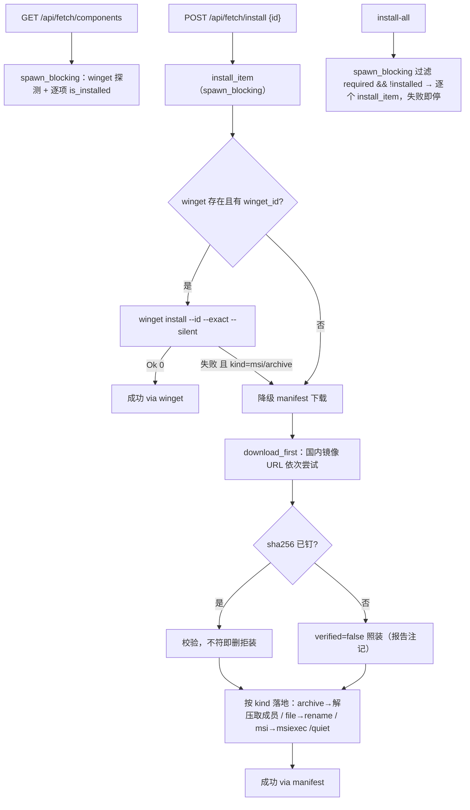
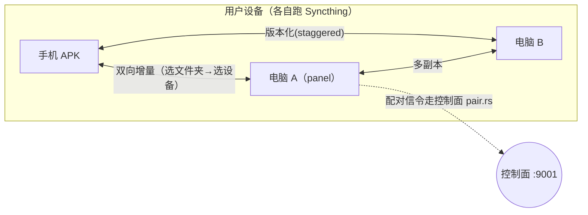

# FlyGo 架构图（Mermaid）

> 本文档用 Mermaid 画清 FlyGo 的架构与关键流程，配合 AGENTS.md 阅读。
> 代码事实来源：panel/src/（main.rs / daemon.rs / smb.rs / tray.rs / api/*）。
> 生成于 2026-09-06 全量代码审读轮（四个逻辑 bug 修复同轮）。

## 1. 系统总架构（四层）

## 2. 启动序列（bind-early，先应答后初始化）

## 3. 退出与 SMB 共享契约（"关软件 = 共享消失"）

## 4. SMB 挂载/热插拔状态机

## 5. 组件拉取系统（T-08，winget 优先双层）

## 6. 同步拓扑（用户视角）

## 7. 本轮审读修掉的四个逻辑 bug（2026-09-06）

| # | 位置 | 症状 | 根因 | 修复 |
|---|---|---|---|---|
| 1 | `api/syncview.rs` 测试 | `live_overview_collect`/`routes` 间歇 panic "config::init() must run before config::get()" | 测试只调了 `settings::init()`，而 `read_apikey` 走 `config::get()`；跑序不同结果不同 | 测试改调 `config::init()`（其内部先冻结 settings） |
| 2 | `main.rs` | T-10 提交信息声称加了 Velopack 钩子，实际从未入库（release exe 也没打进去） | 提交时 main.rs 漏 add | 补回 `VelopackApp::build().on_before_uninstall_fast_callback(smb::close_app).run()` 于 main() 最前 |
| 3 | `api/fetch.rs` | `components`/`install-all` 在 async 上下文里直接跑 `is_installed()`（内部 spawn 子进程、15-20s 超时），会卡死 tokio worker | 阻塞调用没进 spawn_blocking | 状态枚举与缺失过滤整体挪进 spawn_blocking |
| 4 | `smb.rs probe_share` | UI 匿名可达探测失败时也显示"可达" | 脚本输出 `NOK`，代码用 `contains("OK")` 判定，"NOK" 包含 "OK" 子串 | 改为精确匹配 `eq_ignore_ascii_case("OK")` |
